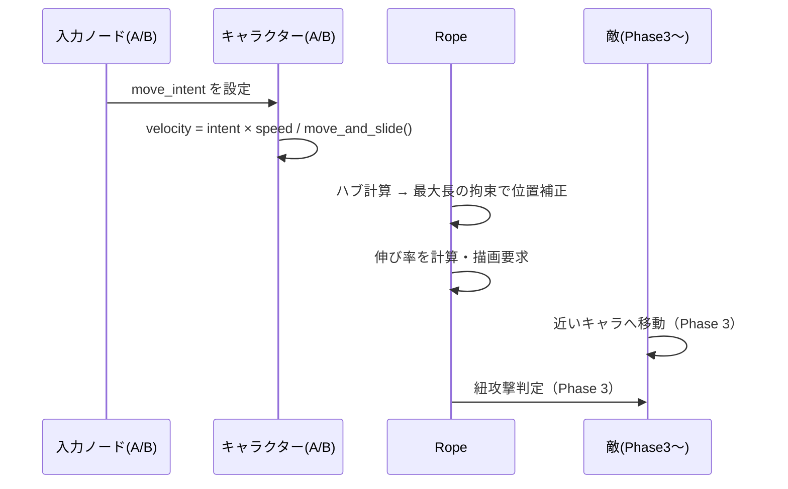
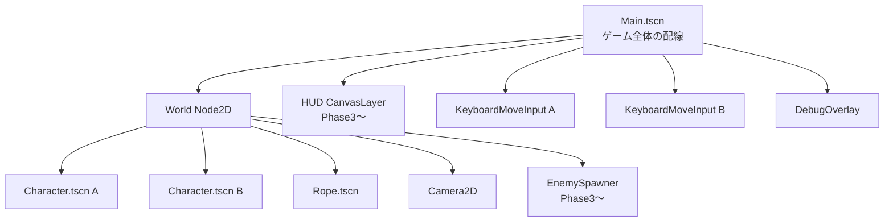
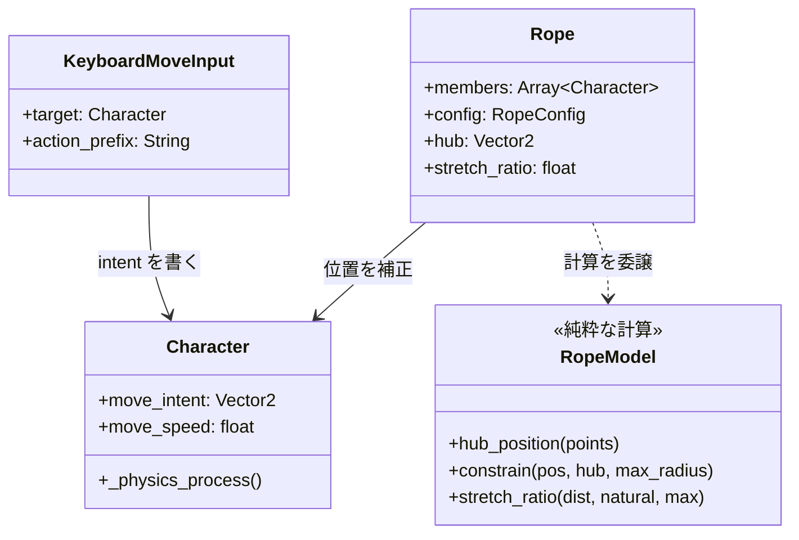
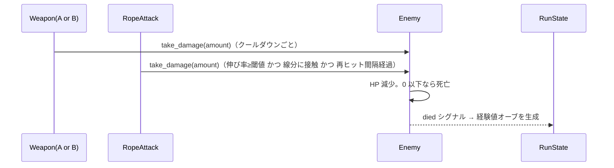
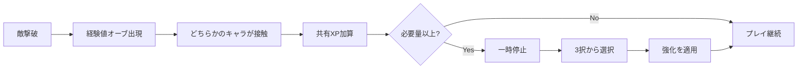

# 基本設計書（初版）

- 版: 0.1（Phase 0）/ 2026-10-19
- 判断の理由は architecture-decisions.md（ADR-xxx）を参照。

## 1. システム構成

```
Windows PC（開発）── Godot 4.7.x エディタ ── 実行・デバッグ
     │                                  └─ 書き出し → Android（APK/AAB）
     │                                  └─ 書き出し → Xcode プロジェクト → macOS で iOS ビルド
     └─ Git ── GitHub リポジトリ（bind-run） ── Claude Code（クラウド）で設計・実装
```

- サーバー・通信なし（ADR は不要なため作らない）。

## 2. ゲームループ

**ゲームループ**とは、「入力を読む → 状態を更新する → 画面に描く」を 1 秒に何十回も繰り返す仕組み。Godot ではエンジンがループを回し、各ノードの次の関数を呼ぶ。

| 関数 | 呼ばれる頻度 | このゲームでの用途 |
|---|---|---|
| `_physics_process(delta)` | 固定間隔（既定 60 回/秒） | 移動、紐の拘束、当たり判定、ダメージ |
| `_process(delta)` | 描画フレームごと | HUD 更新、見た目だけの演出 |
| `_draw()` | `queue_redraw()` を呼んだとき | 紐の線、デバッグ表示 |

`delta` は前回からの経過秒数。速度 × delta で移動量を求めると、処理速度が違う端末でも同じ速さで動く。

### 1 物理フレーム内の処理順（重要）



順番は Godot の `process_priority`（値が小さいノードから先に処理される）で固定する。紐の拘束は **キャラ移動の後** に行わないと、画面上で一瞬最大長を超えて見える。

## 3. シーン構成

Godot の **シーン**は、ノード（部品）を木構造に組んだ再利用可能な単位。Web で言えばコンポーネントに近い。



| シーン | 役割 | フェーズ |
|---|---|---|
| `Main.tscn` | 各部品を組み立て、参照をつなぐ | 1 |
| `Character.tscn` | 1 体のキャラ。A と B は同じシーンを設定違いで 2 つ置く | 1 |
| `Rope.tscn` | ハブの計算、拘束、描画、（後に）紐攻撃 | 1 |
| `Enemy.tscn` | 敵 1 体 | 3 |
| `Title.tscn` / `Result.tscn` | 画面遷移 | 5 |
| `LevelUpPanel.tscn` | 強化選択 UI | 4 |

## 4. 主要オブジェクトと責務



- **Character は紐を知らない。** 紐の都合で位置を直すのは Rope の責任。こうすると「紐なしでキャラを動かすテスト」や「紐の方式の差し替え」が楽になる。
- **RopeModel はノードではない**（`RefCounted` の静的関数）。シーンなしでテストできる。

## 5. キャラクターの移動方式

- `CharacterBody2D`。`velocity = move_intent × move_speed` → `move_and_slide()`（ADR-004）。
- `move_intent` は長さ 0〜1 のベクトル（ベクトル = 向きと大きさを持つ量。ここでは「どちらへ・どれくらい強く」）。斜め入力で速くならないよう長さを 1 以下にする（Godot の `Input.get_vector()` が自動で行う）。
- 加速・減速（慣性）は Phase 1 では入れない。Phase 2 の操作感の調整で検討する。

## 6. ゴム紐の基本仕様（ADR-002, 003）

```
        A
         \   ← 紐 A（長さ dA ≤ R）
          ● ハブ = (A + B) / 2
         /   ← 紐 B（長さ dB ≤ R）
        B
```

| パラメータ | 意味 | 初期値（仮） |
|---|---|---|
| `max_radius` R | 各キャラ〜ハブの最大距離。A〜B の最大距離は 2R | 160px |
| `natural_radius` | これより短いとたるみ（力なし）。Phase 2 | 100px |
| `stiffness` | 弾性区間で引き戻す強さ。Phase 2 | 要検証 |
| `tension_threshold` | 紐攻撃が有効になる伸び率。Phase 3 | 0.9 |

- **伸び率** = (距離 − 自然長) / (最大長 − 自然長) を 0〜1 に収めた値。0 = たるみ、1 = 伸びきり。描画の色・太さと紐攻撃の条件に使う。
- 限界時の補正（Phase 1）: 各キャラを「ハブから最大半径の円の上」に戻す。2 人の場合、2 人がハブへ等しく引き寄せられるため、片方だけが走ると相方は引きずられる。
- 紐は常に直線で、障害物に巻き付かない（仮決定）。
- ハブの表示はデバッグ設定で切り替える。ロジックは表示と関係なく `Rope.hub` の値だけを使う（FR-008）。
- 画面サイズとの関係: 最大距離 2R は **画面の短辺より十分小さく** する。スマホで 2 人が画面に収まらないと遊べないため。

## 7. 敵の行動方式（Phase 3 で詳細化）

- 画面外周のランダムな位置に一定間隔で出現。
- 毎物理フレーム、近いほうのキャラへ向かって一定速度で移動（追跡）。
- 敵同士の押し合いは最初は入れない（処理が重くなるため）。重なりが見づらければ Phase 7 で検討。

## 8. 攻撃とダメージの流れ（Phase 3 で詳細化）



- **武器と紐攻撃は別ノード**（FR-033）。どちらも敵の `take_damage()` を呼ぶだけで、互いを知らない。
- **シグナル**: Godot の「出来事の通知」の仕組み（Web のイベントリスナーに近い）。敵は死亡時に `died` を発信するだけで、誰が経験値を処理するかは知らない。

## 9. 経験値とレベルアップ（Phase 4）



## 10. UI 構成

- HUD（`CanvasLayer` = カメラの動きに影響されない UI 用の層）: HP、XP バー、レベル、残り時間。
- デバッグ表示: FPS、敵数、A〜B 距離、伸び率、ハブ表示切替。
- スマホ（Phase 6）: 左右の仮想スティック。HUD は親指で隠れない上端に置く。

## 11. 入力方式（ADR-005）

| 環境 | A | B | 実装ノード |
|---|---|---|---|
| PC キーボード | WASD | 矢印キー | `KeyboardMoveInput`（Phase 1） |
| ゲームパッド | 左スティック | 右スティック | InputMap に追加するだけ（同じノード） |
| スマホ | 画面左半分の仮想スティック | 右半分 | `TouchStickInput`（Phase 2b/6） |

## 12. データ管理（data-design.md）

- 定義: Resource（`RopeConfig`, `CharacterDef`, `WeaponDef`, `EnemyDef`, `UpgradeDef`）
- 状態: ノードの変数。1 プレイ分の状態（時間・レベル・XP・HP）は `RunState` ノードに集約（Phase 3〜4）。
- 保存（セーブ）は初期版では行わない。

## 13. エラー処理の方針

- 必須の参照（Rope の members など）が未設定の場合は `push_error()` で明確なメッセージを出し、その処理を止める（ゲーム全体は落とさない）。
- 開発中の前提違反は `assert()` で検出する（`assert` はデバッグ実行時のみ有効）。
- 数値の異常（距離 0 での正規化など）は計算関数の中で安全に処理し、単体テストで確認する。

## 14. テスト方針（test-strategy.md）

- 数学・ルール（紐、ダメージ、XP 計算）→ 自動の単体テスト（headless）。
- 操作感・面白さ → オーナーの手動プレイテスト（仮説 H-01〜06 で評価）。

## 15. 将来の拡張方針

- **マルチプレイ（3〜4 人）**: ハブ = 全員の重心、各自がハブから半径 R 以内、という ADR-002 のモデルはそのまま N 人に拡張できる。入力は ADR-005 で分離済みのため、ネットワーク入力を「もう 1 種類の入力ノード」として追加できる。それ以上の準備（同期処理など）は今は行わない。
- **キャラ・武器の追加**: Resource を増やすだけで追加できる構造を目指す（Phase 3〜4 で検証）。
